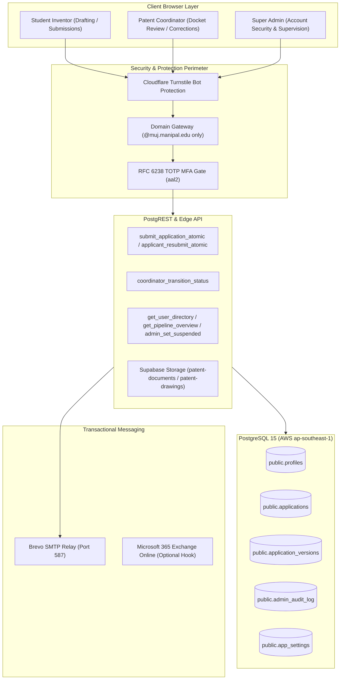
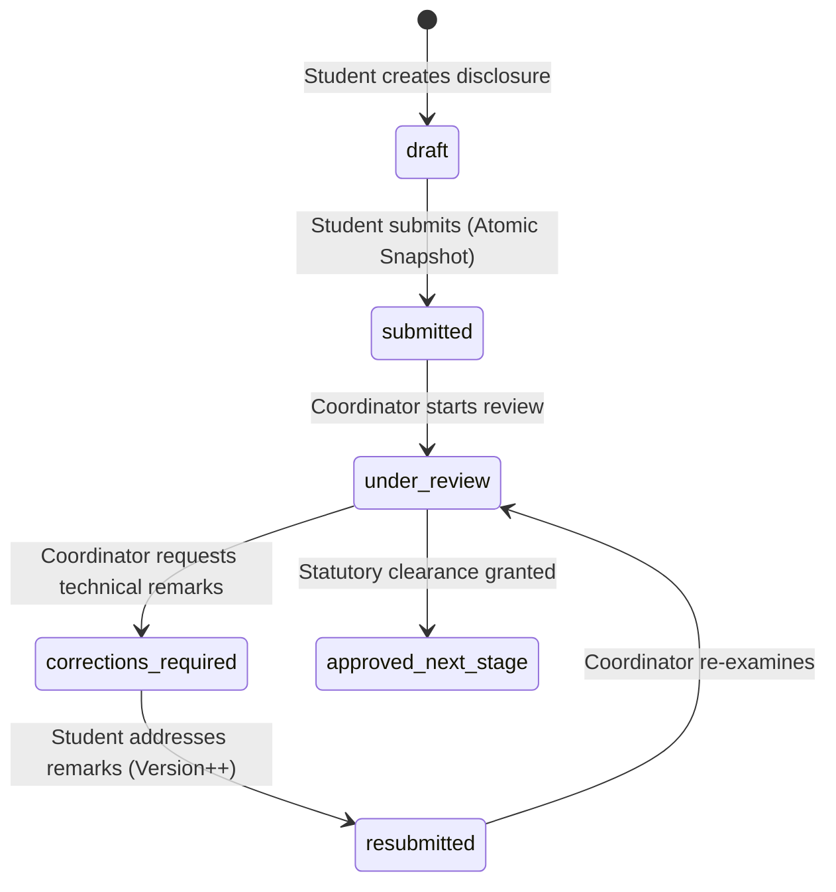

# Architecture & System Overview

**System:** Manipal University Jaipur — Patent Application & Disclosure Portal  
**Maintainer / Lead Architect:** SynthReaper (`codewithaditya8002@gmail.com`)  
**Domain:** `patents.muj.manipal.edu`

---

## 1. System Context & Architecture Diagram

---

## 2. Multi-Tenant Role & Permission Invariants

| Role | Disclosure Read | Disclosure Edit | Administrative Audit | Account Actions | Pipeline Telemetry |
|---|---|---|---|---|---|
| **Student** | Own applications only | Own drafts/resubmissions | ❌ None | ❌ None | ❌ None |
| **Coordinator (`admin`)** | All submitted disclosures | Status & remarks only | ❌ None | ❌ None | Review docket |
| **Super Admin (`super_admin`)** | ❌ **DENIED** (Claims/Drawings masked) | ❌ **DENIED** | ✅ Full read access | ✅ Suspend/Reset/Role | ✅ Stage & Department counts |

---

## 3. Data Integrity & State Machine

Every transition is atomic and executed via `coordinator_transition_status()`, creating an immutable row in `application_status_history`.
