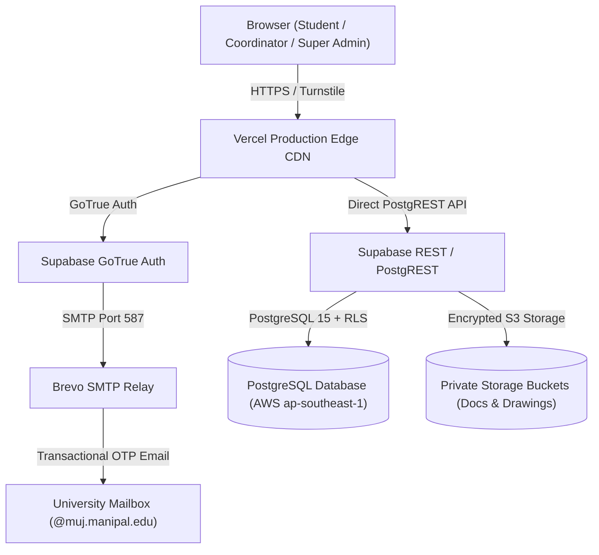

# Production Deployment & Operations Runbook

**Project:** Manipal University Jaipur — Patent Application & Disclosure Portal  
**Platform:** Vercel (Frontend) • Supabase (PostgreSQL 15, Auth, Storage) • Brevo (SMTP Relay)

---

## 1. Architecture & Services



---

## 2. Environment Variables Specification

Configure the following environment variables in the **Vercel Project Dashboard** (and `.env.local` for local staging):

| Key | Example Value | Description |
|---|---|---|
| `VITE_SUPABASE_URL` | `https://cwjnujgzsuphfkbybvoz.supabase.co` | Supabase project URL |
| `VITE_SUPABASE_ANON_KEY` | `sb_publishable_...` | Supabase public anonymous publishable key |
| `VITE_PORTAL_BASE_URL` | `https://ecell-patentportal-git-develop-synthreaper.vercel.app` | Canonical domain for redirects and callbacks |
| `VITE_INSTITUTION_NAME` | `Manipal University Jaipur` | University full name |
| `VITE_INSTITUTION_SHORT_NAME`| `MUJ` | University acronym |
| `VITE_INSTITUTION_WEBSITE_URL`| `https://jaipur.manipal.edu` | University website link |
| `VITE_IPR_CELL_URL` | `https://jaipur.manipal.edu/research/ipr-cell` | IPR Cell website link |
| `VITE_ALLOWED_EMAIL_DOMAIN` | `muj.manipal.edu` | Restricts sign-ups to university addresses |
| `VITE_CONTACT_EMAIL` | `ipr.cell@muj.manipal.edu` | General contact email |
| `VITE_COORDINATOR_NAME` | `Dr. Dorelal Sharma` | Name of current Patent Coordinator |
| `VITE_COORDINATOR_EMAIL` | `dorelal.coordinator@muj.manipal.edu` | Official coordinator email |
| `VITE_STORAGE_BUCKET_DOCS` | `patent-documents` | Private bucket for disclosure PDFs |
| `VITE_STORAGE_BUCKET_DRAWINGS`| `patent-drawings` | Private bucket for CAD/schematics |
| `VITE_APP_ENV` | `production` | Enables strict production guards |
| `VITE_TURNSTILE_SITE_KEY` | `0x4AAAAAA...` | Cloudflare Turnstile public site key |

---

## 3. Database Initial Migration & Setup

To deploy database migrations in order:

1. **Execute Migrations**:
   Run the SQL scripts in `supabase/migrations/` sequentially using the Supabase SQL Editor:
   - `001_initial_schema.sql` (Tables, profiles, RLS, status machine)
   - `20261021000000_init_patent_portal.sql`
   - `20261025000000_verified_auth_and_atomic_workflow.sql`
   - `20261029000000_super_admin_role.sql`
   - `20261029000100_frontend_direct_workflow.sql`
   - `20261029000200_email_otp_verification_and_mfa.sql`
   - `20261031000000_student_authenticator.sql`
   - `20261031000100_fix_signup_trigger_search_path.sql`
   - `20261031000200_super_admin_console.sql`
   - `20261101000000_signup_trigger_security_definer.sql`
   - `20261101000100_remove_sign_in_authenticator.sql`
   - `20261101000200_authenticator_trigger_search_path.sql`
   - `20261105000000_super_admin_rpc_aliases.sql` (Super Admin console RPC aliases)

2. **Reload Schema Cache**:
   ```sql
   NOTIFY pgrst, 'reload schema';
   ```

---

## 4. Brevo SMTP Email Relay Setup

To ensure students receive the 6-digit confirmation codes:

1. **Verify Sender in Brevo**:
   - In Brevo: **Senders, Domains & Dedicated IPs > Senders**.
   - Click **Add a Sender** and verify your sender address via the email confirmation link.
2. **Deactivate IP Blocking in Brevo**:
   - In Brevo: **Security > Authorized IPs**.
   - Click **Deactivate for SMTP keys** so that Supabase's cloud poolers are permitted to connect.
3. **Configure Supabase Auth SMTP**:
   - In Supabase Dashboard: **Authentication > SMTP Settings**:
     - **Enable custom SMTP**: `ON`
     - **Host**: `smtp-relay.brevo.com`
     - **Port**: `587`
     - **Username**: Your Brevo login (e.g. `ae4dd0001@smtp-brevo.com`)
     - **Password**: Your Brevo SMTP Master Key (`xsmtpsib-...`)
     - **Sender email**: Your verified Brevo sender address
     - **Sender name**: `MUJ Patent Application Portal`
4. **Enable Confirm Email**:
   - In Supabase Dashboard: **Authentication > Providers > Email**:
     - Toggle **Confirm email** to `ON`.

---

## 5. Verification & Rollback Procedures

### Verification Commands:
```bash
# 1. Run Vitest suite (82 tests)
npm test -- --run

# 2. Run Database RLS & Workflow verification checks
npm run test:db

# 3. Compile production bundle
npm run build
```

### Emergency Incident Runbook:
- **Temporary Student Sign-up Freeze**:
  ```sql
  UPDATE app_settings SET value = 'false'::jsonb WHERE key = 'registration_enabled';
  ```
- **Reopen Registration**:
  ```sql
  UPDATE app_settings SET value = 'true'::jsonb WHERE key = 'registration_enabled';
  ```
- **Reset Sequence Counter**:
  ```sql
  ALTER SEQUENCE patent_ref_seq RESTART WITH 1;
  ```
